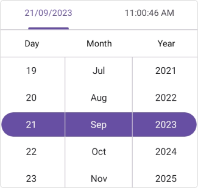

# Getting Started with the .NET MAUI DateTimePicker
This section explains how to add the Date Time Picker control. It covers only the basic features needed to get started with Syncfusion&reg; Date Time Picker.

## Register Syncfusion handler

Make sure to add the namespace.


using Syncfusion.Maui.Core.Hosting;
 

Register the Syncfusion core handler in your `CreateMauiApp` method of `MauiProgram.cs` file to use Syncfusion controls.


builder.ConfigureSyncfusionCore();


## Import the DateTimepicker namespace

Add the following namespace in your XAML or C#.



xmlns:picker="clr-namespace:Syncfusion.Maui.Picker;assembly=Syncfusion.Maui.Picker"


using Syncfusion.Maui.Picker;



## Add the DateTimepicker component

Create an instance of DateTimepicker and add it to your page.



    <picker:SfDateTimePicker />


    SfDateTimePicker picker = new SfDateTimePicker();
    this.Content = picker;



The following gif image illustrates the result of the above code.

N> You can refer to our [.NET MAUI Date Time Picker](https://www.syncfusion.com/maui-controls/maui-datetimepicker) feature tour page for its groundbreaking feature representations. You can also explore our [.NET MAUI Date Time Picker Example](https://github.com/syncfusion/maui-demos/tree/master/MAUI/Picker/SampleBrowser.Maui.Picker/Samples/DateTimePicker/GettingStarted) that shows you how to render the Date Time Picker in .NET MAUI.